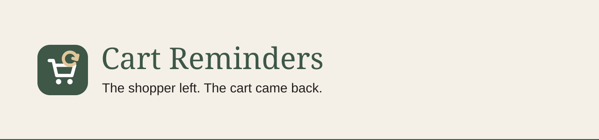

  
  
  
  

**An online store whose left carts come back: a shop built for the business, online ordering and payment, and a friendly reminder when a shopper leaves at checkout.**

[Live site](https://cart-reminders.vercel.app) · press **Try the demo**.

## Status

| Row | What it holds |
|---|---|
| Phase | Live demo |
| Shipped | Landing page and the full demo, on a real Shopify development store and Stripe test mode, at cart-reminders.vercel.app |
| Next | Minor fixes in #3 |
| Updated | 2026-11-13 |

## What it does

- Shows a made-up coffee roaster, Segovia Coffee, whose products come from a Shopify store through the Storefront API.
- Keeps each visitor's cart in Shopify, so a cart outlives the visit.
- Takes payment with Stripe's embedded checkout, in test mode only.
- When the shopper leaves checkout, marks the cart as left and plans two reminders: one after 1 hour, one after 24 hours, then stops.
- A demo clock lets the visitor skip ahead and read the reminder email, whose link reopens the same cart at checkout.
- A paid cart becomes a Shopify test order, and the store owner's side shows carts started, left, reminded and won back.
- A daily job deletes demo orders older than 7 days.

## What it never does

- Never charges a card. Live Stripe keys are refused.
- Never sends an email or a text. The reminder is shown on screen, marked "Not sent".
- Never sets a cookie for the visitor. Cart IDs live in the page's own storage, so the demo works inside a frame (ADR 0002).
- Never plays a real business. Segovia Coffee is made up.

## Stack

| Layer | Choice |
|---|---|
| App | Next.js 16 App Router, React 19 |
| Look | Tailwind 4 with the tokens in `DESIGN.md` |
| Store | Shopify Storefront API (carts, products) and Admin API (test orders) |
| Payment | Stripe embedded checkout, test mode |
| Hosting | Vercel, with a daily cron for cleanup |
| Tests | Vitest |

## Run it locally

1. Node 22 or newer.
2. `npm install`
3. Copy `.env.example` to `.env.local`. For a quick look, set only `SHOP_MODE=fake`: an in-memory shop and checkout, no accounts needed.
4. `npm run dev`, then open the address it prints.

For the real store, `.env.example` names every variable and where it comes from (the Shopify dev store's Storefront and Admin tokens, the Stripe test keys, the webhook secret, `REMINDER_LINK_SECRET`, `CRON_SECRET`). Then load the catalog once with `npm run seed:shopify`.

## Tests

- `npm run test:unit` runs every test.
- Never `npm test`. It fails on purpose.
- CI runs typecheck, lint, `test:unit` and the build on every push and PR.

## Docs

- Spec: [tekguyz-one `docs/superpowers/specs/2026-11-12-cart-reminders-design.md`](https://github.com/tekguyz/tekguyz-one/blob/main/docs/superpowers/specs/2026-11-12-cart-reminders-design.md)
- Plan: [`docs/superpowers/plans/2026-11-12-cart-reminders.md`](docs/superpowers/plans/2026-11-12-cart-reminders.md)
- Look: [`DESIGN.md`](DESIGN.md)
- Words: [`CONTEXT.md`](CONTEXT.md)
- ADRs: [`docs/adr/`](docs/adr/)

---

Built by <a href="https://tekguyz.com">TEKGUYZ</a>

